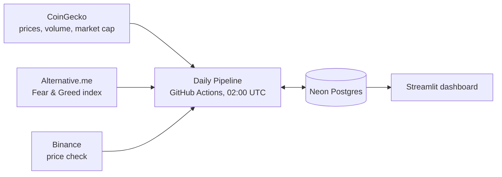

# Crypto 5-Day Picks: Project Guide

Every day this project updates prices for the largest coins tradable on CoinSwitch, forecasts which ones should beat the market over the next 5 days, and shows the top 5 on a Streamlit dashboard.

**Contents**

1. [How it works](#1-how-it-works)
2. [Project structure](#2-project-structure)
3. [First-time production setup](#3-first-time-production-setup)
4. [Run it on your computer](#4-run-it-on-your-computer)
5. [Log in to the database](#5-log-in-to-the-database)
6. [Make and deploy changes](#6-make-and-deploy-changes)
7. [The prediction model](#7-the-prediction-model)
8. [How much to trust the picks](#8-how-much-to-trust-the-picks)
9. [Paper trading](#9-paper-trading)
10. [Settings you may want to change](#10-settings-you-may-want-to-change)
11. [Free plan limits](#11-free-plan-limits)
12. [Troubleshooting](#12-troubleshooting)

---

## 1. How it works



Three separate pieces work together:

| Piece | Where it runs | What it does |
|---|---|---|
| **Daily Pipeline** | GitHub Actions | Fetches data, trains the models, and writes forecasts to the database |
| **Neon Postgres** | Neon, in AWS N. Virginia | Stores everything |
| **Dashboard** | Streamlit Cloud or your computer | Reads from the database and displays results. It never writes |

The pipeline in `pricepredict/pipeline.py` runs these steps in order:

1. **Migrate:** applies any new database changes from `migrations/`.
2. **Ingest:** updates the top 150 CoinSwitch coins from CoinGecko, plus the Fear & Greed index.
3. **Verify:** corrects recent prices that disagree with Binance by more than 25%.
4. **Check freshness:** stops with an error if fewer than 50 coins have recent prices.
5. **Update paper trades:** checks open trades against hourly prices and closes any that have finished.
6. **Choose a model:** FLAML searches for the best settings for about 5 minutes.
7. **Forecast:** trains one model per day ahead (1 to 5) and forecasts every eligible coin.
8. **Pick:** selects the top 5, or none if Bitcoin is below its 30-day average, and opens a paper trade for each pick.
9. **Settle:** records what past picks really earned, after trading costs.
10. **Backtest:** replays the last year, applies the paper-trading rules to it, and saves the results for the dashboard.

If a step fails, the workflow turns red and GitHub emails you. The old pipeline let failures pass silently, which is how it produced nothing for months while appearing healthy.

---

## 2. Project structure

```
price-prediction-app/
├── app.py                  Streamlit dashboard (entry point)
├── pricepredict/           The application code
│   ├── config.py           All settings, in one place
│   ├── db.py               Database connections and migrations
│   ├── ingest.py           CoinGecko and Fear & Greed data
│   ├── binance.py          Checks and repairs prices against Binance
│   ├── features.py         Turns prices into model inputs
│   ├── modeling.py         Models and the FLAML search
│   ├── backtest.py         Replays the past and compares strategies
│   ├── paper.py            Paper-trading rules and reports
│   ├── paper_ledger.py     Opens and settles paper trades in the database
│   └── pipeline.py         The daily job, start to finish
├── migrations/             Numbered database changes, applied automatically
├── scripts/                Tools you run by hand, rarely
├── data/                   CoinSwitch's list of tradable pairs
├── assets/                 Logo
├── tests/                  Automated tests
├── docs/                   This guide
├── .github/workflows/      daily-pipeline.yml (scheduled) and ci.yml (tests)
├── requirements.txt            For the dashboard only
├── requirements-pipeline.txt   Adds ingestion and machine learning
└── requirements-dev.txt        Adds test tools
```

---

## 3. First-time production setup

You only do this once.

### Step 1: Add the secrets to GitHub

In your repository, open **Settings → Secrets and variables → Actions → New repository secret**:

| Name | Value | Required? |
|---|---|---|
| `DATABASE_URL` | The `DATABASE_URL` line from your local `.env` file | Yes |
| `COINGECKO_API_KEY` | A free [CoinGecko demo key](https://www.coingecko.com/en/api) | No, but it makes the ingest about 3 times faster and avoids most rate limits |

Use **secrets**, not variables. Your repository is public, and variables can be seen by anyone.

### Step 2: Push the code

Merge this code into `main`. The Daily Pipeline runs automatically at 02:00 UTC (07:30 IST).

### Step 3: Run the pipeline once by hand

In GitHub, open **Actions → Daily Pipeline → Run workflow**. It should take about 15 to 30 minutes and finish with a green check. If it fails, see [Troubleshooting](#12-troubleshooting).

### Step 4: Deploy the dashboard on Streamlit Cloud

1. Go to [share.streamlit.io](https://share.streamlit.io) and sign in with GitHub.
2. If you already have an app for this repository, open its **Settings**. Otherwise choose **Create app** and pick this repository.
3. Set the branch to `main` and the main file to `app.py`.
4. Under **Advanced settings**, choose Python **3.12**. An existing app may need to be deleted and redeployed to change its Python version.
5. Under **Secrets**, paste this, using your real connection string:

   ```toml
   DATABASE_URL = "postgresql://..."
   ```

6. Save or deploy. The first deploy takes a few minutes.

### Step 5: Clean up old settings

Once a run has succeeded, these are safe to delete from your GitHub repository settings:

- Variables: `AZURE_SQL_SERVER`, `AZURE_SQL_DATABASE`, `AZURE_SQL_CLIENT_ID`, `AZURE_SQL_TENANT_ID`
- Secrets: `AZURE_SQL_CLIENT_SECRET`, `PAT_TOKEN` (the pipeline no longer commits files to the repository)

---

## 4. Run it on your computer

You need [Python 3.12](https://www.python.org/downloads/). Node is not needed.

### Set up once

In PowerShell, from the project folder:

```powershell
python -m venv .venv
.venv\Scripts\Activate.ps1
pip install -r requirements-dev.txt
```

Then make sure `.env` exists and contains `DATABASE_URL`. Copy `.env.example` if it doesn't. Never commit `.env`; it is already in `.gitignore`.

### Run the dashboard

```powershell
.venv\Scripts\Activate.ps1
streamlit run app.py
```

It opens at <http://localhost:8501>. Press `Ctrl+C` in the terminal to stop it. In VS Code you can also use the **Streamlit dashboard** option in the Run and Debug panel.

The dashboard caches database results for an hour. To see new data sooner, open the menu at the top right and choose **Clear cache**.

### Run the pipeline

```powershell
python -m pricepredict.pipeline                                # the full daily job
python -m pricepredict.pipeline --skip-ingest                  # use the prices already stored
python -m pricepredict.pipeline --skip-ingest --skip-backtest --time-budget 60   # a quick test
```

This writes to whichever database `DATABASE_URL` points at. Use a test branch for experiments; see [Test against a copy of the database](#test-against-a-copy-of-the-database).

### Run the tests

```powershell
pytest
ruff check .
```

---

## 5. Log in to the database

### In your browser (easiest)

1. Sign in at [console.neon.tech](https://console.neon.tech).
2. Open the **Tamonash** organization, then the **price-prediction-app** project.
3. Choose **SQL Editor** to run queries, or **Tables** to browse data.

Direct link: <https://console.neon.tech/app/projects/morning-field-26360353/>

### From a SQL tool

DBeaver, pgAdmin, TablePlus and similar tools can all connect using the connection string. Find it in the Neon console under **Connect**, or in your `.env` file. Keep SSL enabled.

### From the command line

The Neon CLI is at `%LOCALAPPDATA%\Programs\neon\neon.exe`, which isn't on your PATH:

```powershell
& "$env:LOCALAPPDATA\Programs\neon\neon.exe" connection-string
& "$env:LOCALAPPDATA\Programs\neon\neon.exe" env pull --file .env -s postgres
```

The second command refreshes your `.env` file. Always include `--file .env`, because the default writes to a different file.

### The tables

| Table | Holds |
|---|---|
| `coin_prices` | Daily price, volume and market cap for each coin |
| `coins` | The coins that can currently be picked |
| `market_sentiment` | The daily Fear & Greed index |
| `coin_predictions` | Forecasts for every coin, 1 to 5 days ahead |
| `positions` | The daily picks and, once closed, what they really earned |
| `model_runs` | One row per pipeline run: chosen model, settings, backtest scores |
| `backtest_periods` | Period-by-period strategy returns from the latest backtest |
| `trade_signals` | Each day's decision, whether to trade or stay out. Written once and never replaced |
| `paper_trades` | Every paper trade: entry, target, stop, exit and return |
| `replay_trades` | The paper-trading rules applied to the latest backtest. Replaced on every run |
| `schema_migrations` | Which database changes have been applied |

### Useful queries

```sql
-- Today's picks
SELECT * FROM positions WHERE open_date = (SELECT MAX(data_through) FROM model_runs) ORDER BY pick_rank;

-- How the current model's closed picks have done
SELECT COUNT(*) AS picks, ROUND(AVG(profit_loss)::numeric, 2) AS avg_return_pct,
       ROUND(AVG((profit_loss > 0)::int) * 100, 1) AS win_rate_pct
FROM positions WHERE profit_loss IS NOT NULL AND model_name <> 'legacy';

-- Did the pipeline run recently?
SELECT created_at, data_through, model_name FROM model_runs ORDER BY id DESC LIMIT 5;

-- Paper trades, newest first
SELECT signal_date, pick_rank, symbol, entry_price, status, exit_reason, net_return_pct
FROM paper_trades ORDER BY signal_date DESC, pick_rank;
```

### Give the dashboard read-only access (recommended)

The dashboard never needs to write. To limit the damage if its secret ever leaks, create a read-only role in the SQL Editor:

```sql
CREATE ROLE dashboard_reader WITH LOGIN PASSWORD 'choose-a-long-password';
GRANT USAGE ON SCHEMA public TO dashboard_reader;
GRANT SELECT ON ALL TABLES IN SCHEMA public TO dashboard_reader;
ALTER DEFAULT PRIVILEGES IN SCHEMA public GRANT SELECT ON TABLES TO dashboard_reader;
```

Then use that role's connection string in Streamlit's secrets. Keep the full-access one for GitHub Actions.

---

## 6. Make and deploy changes

Yes: deploying is essentially pushing to GitHub. Each piece updates on its own.

| When you push to `main` | What happens |
|---|---|
| Any change | CI runs the tests and linter |
| Dashboard change | Streamlit Cloud redeploys within a few minutes |
| Pipeline change | Takes effect at the next run (02:00 UTC, or start it by hand) |
| New file in `migrations/` | Applied automatically at the start of the next pipeline run |

### The everyday routine

```powershell
git checkout main
git pull
git checkout -b my-change

# edit, then test
pytest
ruff check .
streamlit run app.py     # if you changed the dashboard

git add <the files you changed>
git commit -m "Describe the change"
git push -u origin my-change
```

Then open a pull request on GitHub, wait for CI to pass, and merge it. Check the Actions tab after the next pipeline run.

### Change the database

Never edit a migration that has already run. Add a new numbered file instead, such as `migrations/004_add_something.sql`. It runs once, automatically, in filename order, and a failure rolls that file back.

### Test against a copy of the database

Neon branches are instant copies, ideal for trying a risky change or a migration:

```powershell
$neon = "$env:LOCALAPPDATA\Programs\neon\neon.exe"
& $neon branches create --name my-test
$env:DATABASE_URL = (& $neon connection-string my-test).Trim()

python -m pricepredict.pipeline --skip-ingest --time-budget 60
streamlit run app.py

Remove-Item Env:DATABASE_URL
& $neon branches delete my-test
```

### Undo a problem

- **Bad code:** revert the merge on GitHub (**Revert** on the pull request). Streamlit and the next pipeline run pick that up.
- **Bad data:** Neon can restore a branch to a recent point in time, within 6 hours on the Free plan. Choose **Restore** on the branch in the console. There is also a `backup-pre-refactor` branch holding the data as it was before this rebuild.

### Add or change dependencies

- Dashboard needs it: add it to `requirements.txt`.
- Only the pipeline needs it: add it to `requirements-pipeline.txt`.

Pin exact versions (`package==1.2.3`). An unpinned upgrade can quietly change behaviour.

---

## 7. The prediction model

### What it predicts

For each coin, the model predicts its **return over the next 5 days compared with the median coin**. So "+3%" means "about 3% better than the typical coin". The coin can still fall if the whole market falls. The "forecast price" on the dashboard assumes a flat market.

Why not predict the price directly? Tomorrow's price is nearly always close to today's, so a model can look accurate just by repeating it, without knowing anything useful. Market direction is also very hard to forecast, and it swamps the differences between coins. Ranking coins against each other is a more stable question.

### How one model covers all coins

The old approach trained a separate model for each coin on a few hundred rows. The new one trains a single model across all coins, with a few hundred thousand rows. It learns patterns that apply generally, such as how a sharp drop on rising volume tends to play out, and it deliberately doesn't know which coin it's looking at.

### The inputs (51 features)

| Group | Examples |
|---|---|
| Momentum | Returns over 1, 3, 5, 7, 14, 30, 60 and 90 days |
| Risk | Volatility over 7, 14 and 30 days; skew; largest recent daily moves |
| Trend | Distance from moving averages and from 30- and 90-day highs and lows |
| Indicators | RSI, MACD, Bollinger Bands, all scaled so they compare across coins |
| Liquidity and size | Volume, market cap, turnover, volume trends |
| Market backdrop | Bitcoin's trend and volatility, the median coin's return, the share of coins above their 30-day average, Fear & Greed |
| Relative position | Each coin's rank among all coins that day, and its return relative to the market |

We calculate the indicators directly with pandas rather than using pandas-ta or TA-Lib. Those libraries' extra indicators mostly need daily highs and lows, which CoinGecko's free data doesn't include, so they would add installation problems without adding signal.

### The model itself

A **blend of two models**, averaged:

- **A tree model (LightGBM or XGBoost).** FLAML, the AutoML library, chooses the family and its settings each day.
- **A Ridge regression.** It's simple and heavily constrained, and its mistakes differ from the tree model's.

### How FLAML is set up, and why

Used with its defaults, FLAML performed very badly here. It chose a tiny 4-tree model that scored brilliantly on its one validation period and then lost 58% in the backtest. Crypto data is noisy enough that a search can always find settings that happen to suit one period. Two changes fixed that:

- It's scored on **four separate time periods**, using average ranking skill.
- Its search is **limited to well-regularised models**.

### Training and testing without cheating

- **Only known outcomes are used.** A row dated D has a result at D+5, so on any date the model trains only on rows at least 5 days old.
- **Walk-forward testing.** The backtest retrains every 30 days and only ever predicts forward. It never shuffles time.
- **Three years of training data**, which tested better than one year or all history.
- **A test guards against leakage.** `tests/test_features.py` changes future prices and fails if any feature moves.

### Choosing the picks

1. Keep coins that are on CoinSwitch, have 90+ days of history, and trade at least $1M a day.
2. Rank them by 5-day forecast and take the top 5.
3. **If Bitcoin is below its 30-day average, pick nothing.** Without this filter the strategy lost heavily in falling markets.

### Data quality protections

| Problem found | Protection |
|---|---|
| CoinSwitch symbols were treated as CoinGecko IDs, so Bitcoin, Ethereum and most large coins were missing | Coins are now matched by symbol, largest market cap first |
| CoinGecko's history had long stretches of wrong prices, about double the real price for ApeCoin and others in early 2026 | Stored prices are checked against Binance every day |
| Impossible jumps of up to 70,000× in a day | Coins with one-day moves above 5× are ignored |
| One-day spikes that immediately reverse | Removed before training and backtesting |
| Stablecoins and gold tokens could be picked | Excluded by symbol |

---

## 8. How much to trust the picks

**Short version: the model ranks coins better than chance, but it has not proven it can beat simply holding Bitcoin. Treat the picks as a research signal, and don't put in money you can't afford to lose.**

### Results from testing

These tests ran on historical data with the design below, after 1% costs per trade. Each return is the average across 5 possible start days, with the range in brackets, because the start day alone can change the result a lot.

**May to October 2026.** This period was held back from design decisions:

| Strategy | Average return | Range by start day | Ranking skill (rank IC, t-stat) |
|---|---|---|---|
| Old approach, no market filter | −30% | −37% to −13% | −0.021 (−1.6) |
| New model, no market filter | −18% | −33% to −3% | 0.074 (2.5) |
| New model, fixed settings, with filter | **+14%** | −21% to +58% | 0.074 (2.5) |
| New model, FLAML settings, with filter | **+2%** | −6% to +14% | 0.075 (2.3) |
| Hold Bitcoin | +1% | −3% to +6% | n/a |
| Buy every coin | −21% | −25% to −17% | n/a |

**November 2025 to April 2026.** A falling market, also used to choose the design, so these figures are likely flattered:

| Strategy | Average return | Range by start day | Ranking skill (rank IC, t-stat) |
|---|---|---|---|
| Old approach, no market filter | −55% | −61% to −47% | 0.023 (0.8) |
| New model, no market filter | −39% | −54% to −30% | 0.094 (3.1) |
| New model, fixed settings, with filter | −15% | −22% to −8% | 0.094 (3.1) |
| New model, FLAML settings, with filter | −18% | −22% to −13% | 0.077 (2.5) |
| Hold Bitcoin | −17% | −19% to −15% | n/a |
| Buy every coin | −53% | −54% to −51% | n/a |

### What this does and doesn't show

- **Ranking skill is real and is the strongest finding.** Rank IC measures how well the forecasts order coins each day: 0 is random, 1 is perfect. Around 0.07 to 0.09, with a t-stat above 2 in both periods, is meaningful for financial data. The old approach showed no reliable skill.
- **Beating Bitcoin is not proven.** The ranges overlap with Bitcoin's. In the falling market the filtered model roughly matched Bitcoin rather than beating it.
- **Most of the protection comes from the market filter**, which simply stays in cash in weak markets. Without it, the model lost money in both periods, though less than the old approach.
- **FLAML did not clearly beat the fixed settings.** It's used daily because its results were steadier and you wanted AutoML. The gap between +14% and +2% is well within the noise.

### Limits of these tests

- **Survivorship bias.** The tests use today's largest coins, leaving out coins that collapsed and fell off the list. This flatters every strategy, so compare strategies with each other, and don't read the returns as achievable.
- **Short and repeatedly viewed.** A year of data covers few market conditions. The May to October period was also viewed more than once while bad price data was being found and fixed, although the design was not changed after that.
- **Trading isn't modelled in detail.** Real fills differ from midnight snapshot prices, especially for small coins, and taxes are excluded.
- **Some coins can't be verified.** Coins Binance doesn't list can't be price-checked, so they rely on CoinGecko plus the glitch filter.

### What to do with this

1. **Paper trade first.** Watch the dashboard's **Paper trading** section (see [section 9](#9-paper-trading)) for at least 2 to 3 months, ideally through both rising and falling markets. It's the only test that can't be flattered by hindsight.
2. **Compare with Hold Bitcoin.** If the live picks don't beat it after costs, the simpler choice is better.
3. **Add coins that have since been delisted**, if you can get that data, to remove survivorship bias from the backtest.

### Ideas worth testing next

These are untested, so each should have to prove itself in the backtest:

- Limit how volatile a pick can be. Unfiltered picks lost more than their ranking skill suggests, possibly because the most extreme forecasts are the riskiest coins.
- Hold more than 5 coins, or weight them by forecast strength.
- Add derivatives data such as funding rates, if a free source works from GitHub's servers.
- Use daily highs and lows from Binance, which would make indicators like ATR possible.

---

## 9. Paper trading

Paper trading answers one question: if you had taken every suggestion, would you have made money? No real orders are placed.

### The rules

- **Every pick is taken.** On a day with picks, the pipeline buys all 5 on paper. On a "stay out" day it buys nothing.
- **Buying:** at the live price when the picks are published, not the midnight price the model used. GitHub often starts the job hours late, and nobody could buy at a price from hours earlier.
- **Selling:** at +10%, at -5%, or after 5 days, whichever comes first.
- **Costs:** every return is after the 1% round-trip cost, and excludes taxes.
- **One decision per day:** only the first run for a date counts. Running the pipeline again later that day doesn't change what was proposed, which keeps the record honest.

The target and stop are common round numbers, risking 1 to make 2. They weren't tuned on past data. You can change them in `config.py`, but each trade stores its own levels, so past trades keep the rules they started with.

### How exits are worked out

Each day the pipeline reads the hourly prices since a trade opened and walks through them in order, so a trade sold on Tuesday afternoon is recorded at that time even though the job only runs once a day.

- If one hour touches both the target and the stop, it assumes the stop came first, because the order inside an hour isn't known.
- If the price jumps past a level, the trade sells at the price after the jump, not at the level.
- Prices come from Binance where it lists the coin, otherwise from CoinGecko's hourly prices. CoinGecko has no highs or lows, so a short spike between its points can be missed.

### What the dashboard shows

The **Paper trading** section has:

- **Every day's decision:** each date, whether it traded or stayed out and why, trades proposed and taken, and days when the pipeline didn't finish.
- **Every trade:** entry, target, stop, how it ended, its return, and what it would have earned if simply held for 5 days.
- **Which picks would have earned the most?** Total profit from buying only the top 1, 2 or 3 picks each day, or all 5.

Each rule invests the same $100 per day with picks, split equally across the coins it buys, so a rule doesn't look better just by spending more. Because trades last up to 5 days, this can tie up $500 at once.

**Paper-trading rules on the past year**, further down the page, shows the same comparison on the backtest's picks. It's there to give a rough idea while live results build up, and it isn't evidence of real profit: it uses today's largest coins, buys at midnight, checks only daily highs and lows, and covers a period that shaped the model's design.

### Limits

- Real orders on CoinSwitch trade against INR, at prices that may differ from Binance's in USD, and may not fill exactly at the target or stop. Taxes also aren't included.
- Picks can repeat. A coin proposed three days running is bought three times, because each day's suggestion is tested separately.
- The paper entry happens during the pipeline run, before the dashboard shows the picks. The run still has the backtest to finish and the dashboard caches data for up to an hour, so you could only act on a pick somewhat later than its recorded entry.

---

## 10. Settings you may want to change

All in `pricepredict/config.py`:

| Setting | Now | Meaning |
|---|---|---|
| `ROUND_TRIP_COST` | 1% | Cost of buying and selling once. **Check this against your real CoinSwitch fees.** It excludes taxes; India's crypto taxes (1% TDS and 30% on gains at the time of writing) would reduce real returns further, so please confirm your position with a tax adviser |
| `TOP_N` | 5 | How many coins to pick |
| `PAPER_TAKE_PROFIT` | 10% | Paper trades sell at this gain |
| `PAPER_STOP_LOSS` | 5% | Paper trades sell at this loss |
| `PAPER_STAKE_PER_DAY` | $100 | Amount per day in the dashboard's comparison of top 1, 2, 3 and all 5 |
| `UNIVERSE_SIZE` | 150 | How many coins to track |
| `MIN_DAILY_VOLUME_USD` | $1M | Minimum trading volume for a pick |
| `AUTOML_TIME_BUDGET_SECONDS` | 300 | How long FLAML searches |
| `TRAIN_WINDOW_DAYS` | 1095 | How much history the models learn from |

To change the schedule, edit the `cron` line in `.github/workflows/daily-pipeline.yml`. Times are UTC, and GitHub often starts scheduled jobs late.

To refresh CoinSwitch's coin list when new coins are listed, add your CoinSwitch API keys to `.env` and run `python scripts/refresh_coinswitch_pairs.py`, then commit the updated CSV. This script hasn't been run yet, because it needs your keys.

---

## 11. Free plan limits

| Resource | Neon Free plan limit | This project |
|---|---|---|
| Storage | 1 GB per project | About 55 MB now, growing slowly |
| Compute | 100 CU-hours a month | Expected to be well within the limit; check the console after a few weeks |
| Data transfer out | 5 GB a month | The pipeline reads about 15 MB a day, so expected to fit |
| Scale to zero | After 5 minutes idle | The first query afterwards takes a moment to wake the database |

GitHub Actions is free for public repositories. Streamlit Community Cloud is free, but apps go to sleep when unused and wake on the next visit.

**Keep your Neon account active.** Your old Azure database was probably removed when its free subscription ended. Neon's Free plan has no such end date, but check its current terms occasionally. Your data lives only in Neon now, so consider an occasional backup:

```powershell
pg_dump $env:DATABASE_URL --file backup.sql   # requires PostgreSQL's client tools
```

---

## 12. Troubleshooting

| Symptom | Likely cause and fix |
|---|---|
| Dashboard says "Could not read the database" | `DATABASE_URL` is missing. Check Streamlit's **Secrets**, or your `.env` locally |
| Dashboard says "No pipeline run yet" | Run the Daily Pipeline once from the Actions tab |
| Dashboard data looks old | Check the Actions tab for failures. The dashboard also caches for an hour |
| Workflow fails with `Missing DATABASE_URL` | Add the secret in GitHub. Its name must match exactly |
| Workflow fails with `Only N coins have prices` | CoinGecko blocked or rate limited the run. Add a free `COINGECKO_API_KEY`, then rerun |
| Logs show `Rate limited` | Normal on the free tier. It waits and retries |
| Logs show `Skipped the Binance price check` | Binance couldn't be reached. Forecasts still run, without that day's check |
| "Stay out today" appears for many days | Expected whenever Bitcoin is below its 30-day average |
| A migration fails | That file rolled back and the run stopped. Fix it, test on a Neon branch, and push again |
| `No module named pricepredict` | Run from the project's root folder |
